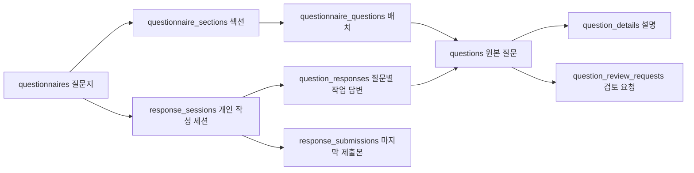

# 질문·질문지·응답 데이터·API·권한

아래는 질문·질문지의 저장 계약이다. 기능은 [질문·질문지 관리](ui.md), 최신 운영 적용 상태와 적용 절차는 [운영 안내](operations.md)를 따른다. 과거 날짜별 적용 기록은 현행 운영 상태와 구분한다.

## 식별자와 테이블

| 테이블 | 역할 |
| --- | --- |
| `questions` | 원본 질문의 본문·답변 필드·조건·행 설정·revision |
| `question_details` | 원본 질문의 설명과 컨설턴트 공개 여부 |
| `questionnaires` | 질문지 제목·작성자·상태·revision |
| `questionnaire_sections` | 질문지의 섹션과 순서 |
| `questionnaire_questions` | 원본 질문을 배치한 위치·섹션·순서 |
| `response_sessions` | 응답 작성자·출처 질문지·상태·구성·revision |
| `response_submissions` | 세션별 마지막 제출 답변·제출 시각·제출 revision |
| `question_responses` | 세션 안 원본 질문별 응답 ID·행·활성 행·본문 |
| `question_review_requests` | 원본 질문별 검토 요청 |
| `question_review_reads` | 요청별 제작자 읽음 기록 |
| `questionnaire_review_reads` | 검토본 확인 기록 |

질문지 버전 테이블과 질문 버전 테이블은 제거했다. 질문지는 `questionnaireId`/`questionnaire_id`, 원본 질문은 `questions.id`로 식별한다. `questionnaire_questions.id`는 배치 ID이므로 원본 질문 ID와 다르다. `legacy_parent_id`는 과거 ID 추적용이며 현재 식별자로 사용하지 않는다.

`question_responses.question_id`는 원본을 직접 참조한다. `session_id` → `response_sessions.origin_questionnaire_id`로 출처 질문지를, `respondent_id`로 작성자를 구분한다. 같은 원본이라도 질문지가 다르면 응답 세션과 응답이 다르다. 동일 세션·원본 질문의 중복 응답은 금지한다. 응답 JSON은 `questionId`를 반환한다.

## 저장과 권한

질문은 `save_question`, 질문지는 `save_questionnaire_draft`로 저장한다. `revision`과 요청 ID로 충돌·중복 재시도를 보호하고, DB가 실제 역할·작성자·배치 소속·선행 관계를 검사한다. 표시 역할 전환은 실제 권한을 바꾸지 않는다. 질문과 설명은 원자적으로 저장하며 details 생략은 보존, 빈 배열은 삭제다.

공유되지 않은 독립 질문은 작성자·관리자가 조회·수정한다. 활성 검토 질문지의 원본은 다른 리드도 조회·수정할 수 있다. 검토본 공유 조회는 해당 질문지의 원본만 허용하는 별도 경로다. 작업 중 응답은 본인만 읽고 저장하며 검토 중 단계 실제 저장은 지정 가이드 계정에 제한한다. 다른 리드는 저장 없는 미리보기다.

가이드 응답은 최신 질문과 질문지 구성을 읽는다. 질문 변경 시 `OLD.fields`와 새 필드의 ID·유형을 비교해 호환 답변은 유지하고 삭제되거나 유형이 바뀐 필드의 답변만 지운다. 가이드 답변이 있으면 저장 API가 확인 동의를 검사한다. 이전 답변 보관·구조 변경 재작성 안내는 제공하지 않는다. `definitionToken`으로 오래된 구조의 저장을 거절한다.

질문지에서 질문·섹션을 제거할 때 가이드 응답이 있으면 확인한다. 저장 시 해당 질문지 세션의 응답만 삭제하고 다른 질문지의 응답·원본은 유지한다. 재배치는 빈 응답으로 시작한다.

배포 응답은 `question_responses`에 본인 작업 내용을 저장하고 제출 시 `response_submissions`에 활성 답변만 갱신한다. 제출 후 저장은 공개본을 바꾸지 않는다. 리드·관리자는 제출본만 조회할 수 있으며 원본 작업 응답 RLS는 본인 전용이다. 질문 정의는 잠긴 원본을 읽고 복제하지 않는다. 세션 유일성은 작성자·질문지·시작 단계 조합이며 가이드 검토 중 응답과 개인 배포 응답을 분리한다. 가이드 예시는 검토 중 단계 응답만 읽는다.

## 배포와 삭제

배포는 원본 질문별 미처리 검토 요청이 없어야 가능하다. 배포된 질문지와 포함된 원본·설명은 수정/삭제가 차단된다. 같은 원본을 사용하는 다른 질문지에서도 원본을 바꿀 수 없다.

저장된 배포 응답이 없으면 같은 질문지 ID로 검토 중/수정 중으로 돌아갈 수 있다. 빈 열람 세션과 검토 중 가이드 응답은 이 판정에서 제외한다. 다른 배포본이 사용하는 원본은 잠금을 유지한다.

질문 제거는 원본 삭제가 아니다. 원본 삭제 API는 archive 방식이며 배치·참조·배포 잠금 검사를 따른다. 질문지 삭제는 기존 응답 세션을 보존한다. 검토 요청은 원본에 귀속되며 출처 질문지 삭제로 사라지지 않는다.

## 구형 호환과 이력

원본 없는 구형 배포 응답만 `legacy_question_id`와 `legacy_definition`으로 기존 정의를 보존한다. 새 원본 응답에는 두 열이 NULL이다. 구형 응답 테이블은 제거했지만 기존 공개 저장 RPC와 호환 경로는 유지한다. 새 배치형 배포본은 별도 published-responses API로 저장·제출한다.

과거 migration·이전 장부·SQL 스니펫은 현재 기능과 구분한다. 폐기된 import 함수를 재실행하지 않는다. 미사용 구조 점검을 실제 질문지·응답 데이터 삭제 요청으로 해석하지 않는다. 과거 데이터 복원 기록은 Git 이력에서 확인할 수 있다.

## 표형 응답 표시 설정 (2026-10-11)

원본 `questions`의 `answer_layout`은 `cards`(기본), `table`, `flow` 중 하나다. `initial_rows`는 일반 표의 초기 표시 행 수이며 1~20, 반복형에서는 `max_rows` 이하이고 단일/참조형에서는 1이다. 필수 작성 행 수는 기존 `min_rows`로 유지한다. 흐름표는 기존 `row_labels`의 시기를 가로로 표시하고 `fields`의 항목을 세로로 표시하며 참조형 행 구성과 함께 쓰지 않는다. 새 답변 테이블·별도 복제 정의를 만들지 않고 기존 질문 ID·열 ID·응답 행 ID·값 형식을 유지한다.

`fields[].required` boolean은 일반 표/카드에서 해당 열의 제출 필수 여부다(생략 시 true). 흐름표의 칸은 부분 작성 가능하며 최소 작성 시기 수를 적용한다. 표/흐름표의 빈 표시 행은 활성 행 수에서 제외하되 원본 작업 답변의 행 배열은 보존한다. 제출 흐름표에도 원래 행 순서와 빈 시기 자리를 유지하고 비활성 행의 내용은 공개하지 않는다. `20261011143258_question_answer_layouts.sql`은 2026-10-12 운영 적용·회귀 검증을 완료했다. 로컬 DB 엔진 부재로 로컬 SQL 회귀는 미실행이다.

### 흐름표 중간 시기 (2026-10-13)

`questions.flow_insert_after`는 NOT NULL JSONB 배열이며 기본값은 `[]`다. API의 `flowInsertAfter`는 추가를 허용할 기본 시기의 1부터 시작하는 고유 번호 배열이다. 기본 시기 수는 단일 행에서 1, 반복 행에서 기존 `max_rows`이고 각 번호는 이 범위 안에 있어야 한다. 빈 배열은 모든 표시 방식에 허용하며 비어 있지 않은 배열은 기본 시기가 19개 이하인 흐름표에만 허용한다. `max_rows`를 추가 시기까지 포함하는 값으로 바꾸지 않으며 응답의 기본·추가 시기를 합친 상한은 20행이다. UPDATE에서 흐름표의 설정이 생략되면 기존 배열을 보존하고 명시적 `[]`는 해제한다. 흐름표 외 표시 방식은 빈 배열로 정리한다.

흐름표 응답 행은 `{id, answers, flowIndex?, flowAfter?, label?}`다. 고정 시기는 `flowIndex`에 기본 번호를, 추가 시기는 `flowAfter`에 기본 시기 다음의 위치를 저장한다. 두 속성은 함께 사용하지 않으며 `label`은 추가 시기의 최대 100자 이름이다. metadata가 있는 응답에는 모든 기본 시기의 고유 번호가 필요하다. 저장은 기본 시기·그 뒤 추가 시기 순으로 정렬하며 기존 행 ID와 열 답변을 그대로 유지한다. 기존 metadata 없는 흐름표는 위치 기반 계약을 계속 지원하고 최초 전환 때도 기존 위치의 행 ID를 보존한다. 이 metadata는 카드·일반 표·참조 행에는 허용하지 않는다.

추가 위치 해제 후에는 저장된 추가 행의 같은 ID·위치만 계속 편집할 수 있고 신규 추가는 거절한다. 저장된 시기 metadata가 있으면 원본의 기본 시기 수 또는 흐름표 표시 방식을 바꾸는 수정은 `55000`으로 차단한다. 답변이 있는 추가 시기는 완료 시 공백이 아닌 이름이 필요하고, 이름만 있는 행은 활성 행·최소 작성 수에서 제외한다. 제출본은 빈 고정·추가 자리의 metadata를 보존하고 비활성 답변은 `{}`로 정리한다. 흐름표의 활성 행이 하나도 없으면 추가 시기 이름도 빈 문자열로 정리하여 조건상 숨겨진 입력을 공개하지 않는다. 가이드 이름은 이동한 배열 위치 대신 고정 번호 또는 추가 이름으로 계산한다. 새 migration은 `20261013033907_question_flow_insertions.sql`이며 기존 ID·RLS·가이드 계정·원본 및 배포 잠금을 유지한다.

## 질문지 시작 안내 (2026-10-15)

`questionnaires.start_notice`는 nullable JSONB `{title,body,buttonLabel}`이며 API의 조회 문서 및 작업 응답 스냅샷에서는 `startNotice`다. 기존 questions의 제목·prompt 서식 원문·button_label을 그대로 이전한다. 답변 모델과 독립적이며 학습법은 기존 study 저장 경로만 사용한다. 새 테이블/공개 RPC나 강제 등록 검증은 추가하지 않는다.

기존 read_questionnaire_draft/read_shared_questionnaire 및 private 작업 응답 조회 함수의 반환에 추가하되 소유자·역할·RLS·함수 ACL은 유지한다. 일반 저장 schema는 선택적인 startNotice를 전달한다. 미전달은 기존 안내 보존, null은 삭제, 객체는 교체한다. title 200자/body 20000자/buttonLabel 100자 이내이며 빈 buttonLabel은 등록 버튼 없는 일반 안내다. 기존 원자적 저장 함수의 최종 UPDATE에서 revision과 함께 저장한다. 저장 재시도 해시에 안내도 포함하며 원격 동기화/변경 감지 대상이다. 직접 변경은 guard_start_notice가 차단하고 기존 definer 저장 경로의 역할·소유자/검토 중 공유·배포/보관 잠금을 유지한다. 질문 제작에서 purpose 선택은 없애고 API 및 DB가 새 study_registration 저장을 거절한다. 원본 보관/과거 캐시 읽기 호환을 위해 기존 purpose 열·렌더러·빈 답변 처리 코드는 당장 제거하지 않는다.

이전은 전체 트랜잭션·잠금 아래 질문지당 안내 1개, 미배치 안내/부가 설명 없음 조건을 검사한다. 기존 세션·응답·제출 이력은 허용하지만 안내에 연결된 작업 응답·제출 항목·저장 재시도 값이 비어 있고 출처/배치 연결이 일치해야 한다. 실제 답변·과거 답변·들어오는 응답 참조·예상 밖 값은 삭제하지 않고 롤백한다. 빈 안내 응답 자리만 삭제하고 세션 layout에서 안내 배치와 그 결과 비는 섹션, 제출본/재시도 payload에서 안내 키만 제거한다. 원본은 archived_at으로 보관한다. 나머지 질문·섹션·답변 ID/내용/시각과 세션 revision·저장 ID·자유 응답·최종 제출 시각을 보존하며 제출 후 비공개 수정분을 제출본으로 복사하지 않는다. 질문지 자체 revision 증가로 기존 편집 캐시 충돌을 감지한다. 관련 보호 트리거는 대상 이전 동안만 잠금 아래 해제하고 같은 트랜잭션에서 복구하며 전후 데이터 지문을 비교한다. 운영에 미적용인 시작 안내 migration의 데이터 이전만 보완했으며 이미 적용된 로컬 DB의 재실행·이력 repair는 필요 없다. 검증·적용 순서는 [운영 문서](operations.md)의 최종 사전 점검을 따른다.

- 배포본 작성자 이름 누락 수정: 기존 shared_questionnaire_authors RPC가 활성 검토 중·배포본의 created_by 이름을 반환한다. 관리자/리드만 호출 가능하며 초안·보관본은 제외한다. 서버도 배포본만 있을 때 RPC를 호출한다. 반환 구조는 유지하며 현행 RPC 이름은 shared_questionnaire_authors다. 20261014064007_distributed_questionnaire_authors.sql 로컬 적용 및 SQL 회귀 통과(가상 데이터 롤백), 운영 미적용.

### 이름 있는 비흐름표의 제출 투영

`20261014075610_submitted_named_row_labels.sql`부터 원본 `answer_layout != flow`이고 `row_labels`가 있으면 제출 스냅샷의 활성 `rows[]`에 원래 배열 순서에서 계산한 `label`을 추가한다. 빈 이름이나 설정 범위 밖 항목은 원래 순서의 `항목 N`을 사용한다. 비활성 행을 제외하기 **전**의 순서를 사용하므로 중간 빈 행 때문에 이름이 이동하지 않는다. 이 메타데이터는 제출 조회 전용이며 카드·일반 표의 작성 요청과 `question_responses.rows`에는 계속 허용하지 않는다. 기존 흐름표의 `flowIndex`·`flowAfter`·`label` 계약은 유지한다.

기존 제출본 보정은 저장 RPC와 동일한 세션 행 잠금을 획득한 뒤 다시 조회한다. 제출 revision과 작업 세션 revision이 같고, responseId·questionId·활성 ID·전체 활성 행 투영이 일치할 때만 이름을 보정한다. 후속 비공개 편집이 있거나 내용·순서가 일치하지 않으면 손대지 않는다. 답변 값·제출 시각·revision은 변경하지 않는다. 복원할 수 없는 구형 압축 행은 UI/PDF에 이름 미확인으로 표시하며 ID를 순서로 해석하지 않는다. 서버가 이미 제공한 가이드 행 이름은 행 ID에 연결해 표시하고 같은 label끼리 병합하지 않는다.

## 독립 첨부형 전환 계약 (2026-10-14)

필드 kind는 `text|scale|single|multiple`만 허용한다. `20261014082243_convert_question_attachments_to_mentions.sql`은 기존 질문 필드를 동일 ID/라벨/필수 여부의 text로 바꾸고 해당 참조 권장을 켠다. 질문 revision을 증가시키고 재시도 식별자를 갱신하여 오래된 정의 저장을 차단한다. 행 ID·label·flow metadata·다른 답변은 보존한다. `question_responses.rows`, `response_submissions.answers`, `response_sessions.last_payload.answers`를 각각 원본 UUID로 변환하며 작성 중 내용을 제출본에 복사하지 않는다. 최종 제출 시각/revision·응답 생성/수정 시각·본문 요약은 유지하고 실제 상세 본문은 변환한 rows를 사용한다.

전환은 명시적 단일 트랜잭션·5초 잠금 대기 제한·대상 테이블 독점 잠금 아래 수행한다. 질문 검증/배포 잠금/가이드 정리 트리거만 잠시 중지한 뒤 같은 트랜잭션에서 복구한다. 일반 수정·배포 잠금 정책은 유지한다. 원본 없는 구형 정의/이전 정의에 폐기 유형이 있거나 첨부 UUID를 비교하는 조건, 잘못된 UUID가 발견되면 전체 롤백하고 별도 검토한다. 현재 로컬·운영 사전 조회에서는 해당 사례가 없었다.

참조 제목은 개인정보를 복제하지 않는 `첨부한 탐구활동`/`첨부한 학습법`이며 mark의 UUID만 유지한다. 참조 대상·파일은 기존 인증/RLS로 조회한다. 학습법 가이드 권한 함수의 독립 UUID 분기를 제거하고 기존 본문 mark 조회만 사용한다. public 권한·RLS·함수 ACL은 바꾸지 않는다.

## 질문 조회 집계 모델 (2026-10-15)

`20261015051602_question_read_models.sql`은 저장 테이블 변경 없이 조회 함수 두 개와 인덱스 하나를 추가한다.

- `question_review_counts(p_question_ids uuid[]) → jsonb`: `{counts: {questionId: number}, unreadCounts: {questionId: number}}`. 미처리 요청을 DB에서 집계하며 0건 키는 생략할 수 있다. 호출자는 누락된 키를 0으로 해석한다. 기존 요청 열람 RLS를 사용하고 미확인은 원본 작성자/타인 요청/읽음 기록 없음 조건을 유지한다.
- `question_incoming_references(p_question_ids uuid[]) → jsonb`: `[{target_id,id,title,created_by}]`. source/after/condition 중 하나라도 대상 ID를 참조하는 활성 질문만 반환한다. 대상 ID 중복과 복수 관계를 중복 집계하지 않으며 대상·참조 질문 모두 RLS 범위 안에 있어야 한다.
- 두 함수는 1~10개의 null 아닌 UUID 배열을 받는다. `SECURITY INVOKER`, 빈 `search_path`, 명시적 authenticated 실행 권한, 관리자/리드 역할 검사를 사용한다. 테이블 권한을 확대하지 않는다.
- `questions_active_condition_idx`: 활성 질문의 `condition`에 대한 `GIN(jsonb_path_ops)` 인덱스. 원본 `condition` JSONB와 source/after 열이 계속 관계의 단일 저장 원본이며 관계 복제 테이블을 만들지 않는다.

질문·설명 원자적 저장, revision/saveId, 가이드 응답 삭제 확인, 배포 잠금, 응답 행 ID와 제출 스냅샷에는 변경이 없다. 앱 저장 schema에서 설명 항목 ID 중복을 추가 검사하며 기존 DB 검사와 일치시킨다. 제출 검증 변경은 별도 후속 작업이다.

### 설명 항목 계약 정리 (2026-10-15)

설명의 저장 원본은 `question_details`이며 별도 API/독립 revision을 추가하지 않는다. 설명 타입·현재 검증 제한은 `lib/question-details.ts`를 공유한다. 구형 로컬 질문지 초안의 넓은 설명 제한은 `savedDraftSchema`의 읽기 호환 경로에만 남긴다. 빈 설명의 숨김은 표시 단계에서만 수행하며 ID·본문·공개 여부·표시 순서와 저장 데이터는 변경하지 않는다. 기존 DB 스키마/권한 변경 및 데이터 이전은 없다.

### 검토 요청 페이지 조회 (2026-10-15)

`20261015054101_question_review_paged_reads.sql`은 `read_question_review_page(qid uuid, origin_id uuid default null, completed boolean default false, page integer default 1) → jsonb`를 추가한다. `SECURITY INVOKER`/빈 search_path이며 기존 요청 RLS와 can_read/can_request 권한 함수가 계속 적용된다. 비로그인 실행을 허용하지 않는다. 미처리는 전부 반환하고 완료는 10개씩 반환한다. page는 1~100000이며 동률 정렬은 ID로 고정한다. 미처리/완료 count는 페이지 길이와 별개다. 완료 조회는 읽음을 변경하지 않는다.

완료 이력용 partial index는 `(question_id,created_at DESC,id DESC) WHERE resolved_at IS NOT NULL`이다. 기존 요청·읽음 테이블, FK/삭제 정책, 생성·처리·읽음 RPC는 변경하지 않는다. 기존 전체 조회 RPC는 호환용으로 남기고 새 화면의 주기 조회는 페이지 RPC를 사용한다. migration 생성 시 이전 질문 집계 두 함수의 익명 실행 권한도 명시적으로 회수하여 현재 로컬의 권한 상태와 재생 결과를 맞춘다. 인증 사용자 권한은 그대로다.

### 질문 귀속 검토·내용 복사 (2026-10-15)

- `20261015055947_question_owned_reviews.sql`은 private can_request/request 함수를 교체하고 이전 단계 페이지 조회 RPC의 anon 실행 권한을 명시적으로 회수한다. 질문·요청·읽음·응답 테이블과 기존 행을 수정하지 않는다. 기존 origin_questionnaire_id 값은 과거 출처 정보로 보존하고 FK의 SET NULL도 유지한다. 새 요청은 항상 origin_questionnaire_id=NULL이다.
- 기존 RPC의 출처 인자/signature는 구형 클라이언트 호환을 위해 유지하지만 권한과 중복 요청 검사에서는 무시한다. API는 항상 NULL로 전달한다. 원본 질문 작성자 제외 + admin/consultant_lead + 활성 검토본에 포함된 질문이라는 조건을 조회와 저장에 동일 적용한다. 질문지 작성자 제외 조건은 제거한다.
- 저장 시 원본 질문과 활성 검토 중 배치를 잠가 상태 변경과 경합을 방지한다. 중복 요청 ID는 질문·요청자·본문이 같은 경우에만 재시도로 인정한다. 기존 요청 처리/읽음/조회 RLS와 권한은 유지한다.
- 새 질문 불러오기는 클라이언트에서 정의만 독립 복사한 뒤 기존 save_question에 revision 0으로 저장한다. 별도 복제 테이블이나 원본 연결을 만들지 않는다. 필드·선택지·설명 ID를 새로 만들며 응답/가이드/검토 이력은 전달하지 않는다. 외부 질문 연결은 복사하지 않는다.

- startNotice에 선택 문자열 explorationButtonLabel(최대 100자)을 저장한다. 미지정/빈 문자열은 탐구활동 버튼 숨김이다. 기존 JSONB와 원자적 저장 경로를 그대로 사용하며 신규 migration은 없다.

### 기본 비공개 질문·질문지 초안 권한 (2026-10-15)

- 별도 검토 중/배포가 없는 독립 질문은 작성자·관리자만 조회/수정한다. 기존 질문 정책을 유지한다.
- 수정 중인 질문지는 작성자·관리자만 조회/수정한다. questions와 달랐던 questionnaires SELECT RLS를 제한하며 하위 섹션·질문 배치는 부모 RLS를 따른다. 관리자 초안 조회/저장 RPC 및 안내 편집을 허용한다.
- 서버 목록/상세와 공통 목록 모델은 관리자 초안을 표시한다. canEditDraft는 편집 권한 표시이며 isOwner는 실제 소유권으로 유지한다. 내 질문지 필터나 검토 중·배포 권한을 관리자 소유로 위장하지 않는다.
- 검토 중/배포/보관 정책은 이번 변경에서 확대하지 않는다. 기존 데이터·ID·revision과 함수 ACL은 유지한다. migration은 기존 권한 정의가 예상과 다르면 중단한다.

## 검토·배포 상태 저장 계약 (2026-10-15)

| 의미 | questions/questionnaires 연결 | DB 상태/시각 |
| --- | --- | --- |
| 비공개 제작 | 작성자·관리자만 초안 조회/수정 | `draft`, 시각 둘 다 NULL |
| 검토 중 | 질문지와 원본을 다른 리드에게 공개, 공동 편집 | `in_review`, `review_started_at` |
| 배포 | 컨설턴트 응답, 질문지·원본·설명 잠금 | `published`, `review_started_at`와 `published_at` |

보관은 별도 상태값으로 저장하지 않고 `archived_at`으로 표시한다. 상태 변경 명령의 archived는 이 플래그를 설정한다. 질문 잠금 열은 `questions.publication_locked_at`, 응답 세션의 `started_stage`는 `in_review|published`다. 검토본 읽음 테이블은 `questionnaire_review_reads`이며 질문 검토 요청의 `question_review_reads`와 별개다. Realtime의 일반 컨설턴트 채널은 `questionnaires:published`다.

`start_questionnaire_review`가 검토를 시작하고 `publish_questionnaire`가 배포한다. 공용 원본/문서 조회는 `read_shared_question_sources`/`read_shared_questionnaire`, 작성자 조회는 `shared_questionnaire_authors`다. 가이드 세션은 `open/read/save_review_response_session`, 배포 세션은 `open/read/save_published_question_response_session`이다. 구형 원본 없는 응답용 RPC는 `open/read/save_published_response`로 구별한다. 배포 집계/응답 상태는 `published_submission_counts`/`published_response_statuses`다.

public `publish_questionnaire`와 `change_questionnaire_status`는 필수 `p_workflow_version integer` 인자를 추가하고 2만 받는다. 같은 이름의 구형 시그니처는 제거하여 이전 publish 요청을 배포로 오인하지 않는다. private 구현의 역할·소유권·권한 범위는 그대로다. 기존 함수는 OID·ACL·보안 속성을 유지하여 rename/recreate하고 새 시그니처의 public wrapper는 invoker·빈 search_path·authenticated/service_role EXECUTE만 허용한다.

`20261015075725_questionnaire_review_publication_workflow.sql`은 한 트랜잭션에서 old published→in_review, old distributed→published를 CASE로 이전하고 시각 열을 rename한다. ID·revision·작성/수정/제출 시각·질문/답변/제출/검토/읽음·상태 요청 영수증은 보존한다. 본문 JSON은 일괄 문자열 치환하지 않는다. 원래 함수 75개의 정의 지문과 전후 모든 관련 행의 정렬 체크섬·개수를 검사하고 예상 밖 드리프트·단계·데이터 차이가 있으면 전체 롤백한다. 트리거는 전환 대상 표에서만 중지하고 기존 enabled 상태를 복구한다. 과거 요청 영수증은 그대로 보존하며 구형 상태 fingerprint와 충돌하는 재시도는 안전하게 거절한다.

## 응답 무결성·제출 조회 계약 (2026-10-15)

`20261015090145_response_integrity_and_submission_reads.sql`은 다음을 추가한다. 기존 질문·응답·세션·제출 ID, 저장 답변, 제출 시각/revision과 RLS를 보존한다.

### 질문에 귀속된 필수 시기

`questions.response_requirements`는 nullable JSONB다. API 문서 속성은 `responseRequirements`이며 값은 `{kind:"career_flow",startFieldIds:[UUID,UUID],admissionFieldId:UUID}`다. 기본 null은 기존 일반 검증이다. 세 ID는 서로 다르며 해당 질문의 서술형 필드를 참조해야 한다. 질문 schema와 DB CHECK가 이를 검사한다. 원본 진로 흐름 한 건에만 기존 필수 시기를 backfill하고 이미 존재하는 다른 질문/복제를 추정하여 변경하지 않는다.

질문 저장에서 속성 생략은 기존 값 보존, 명시적 null은 프리셋 해제다. 현재 제작 UI에 별도 프리셋 설정 컨트롤을 추가하지 않는다. 질문 불러오기는 모든 필드 ID를 새로 발급하면서 필수 시기 ID도 매핑한다. 프리셋이 남아 있는 동안 필수 열 삭제/유형 변경은 검증 오류다. 배포된 원본은 이 속성도 기존 불변성 트리거로 보호한다.

배포 답변 제출 시 활성 응답에서 시작 그룹 둘 중 하나와 원서 접수 필드에 유효 서술형 답변이 각각 있어야 한다. 나머지 칸의 부분 입력 정책은 유지한다. 조건상 비활성 질문은 서버 검사를 건너뛴다. 임시 저장에는 완료 검사를 적용하지 않으며 과거 제출본은 재검증/취소하지 않는다. `private.prepare_question_response_rows`는 가이드/배포 저장의 중복된 행 구조·개수·필드 소속·값 유형·흐름표 정규화를 공유한다. 접근 제어·조건·완료·제출 스냅샷 처리는 각 기존 저장 함수에 유지한다.

### 제출 조회 API

모든 경로는 기존 `X-Questionnaire-Workflow: 2`, 로그인·실제 역할·표시 역할 검사를 따른다. 리드/관리자만 접근하며 DB도 활성 배포 질문지와 요청한 세션의 출처/시작 단계를 재검사한다. 비로그인 실행 권한을 부여하지 않는다.

| GET `/api/questionnaires/:id` 하위 경로 | 반환 및 RPC |
| --- | --- |
| `/submitted-responses?page=N` | `{items:[{id,respondentName,submittedAt,revision}],total,page,pages}`. 10개 고정, N=1~100000, 초과 마지막 페이지 보정. `read_submitted_response_page` |
| `/submitted-responses/:sessionId` | 마지막 제출 snapshot과 잠긴 질문 정의. 세션의 출처 불일치/없는 제출은 404. `read_submitted_response` |
| `/submitted-responses/:sessionId?revision=N` | 내보내기용 동일 상세. 제출 revision 불일치는 409 |
| `/submitted-responses/manifest` | `[{id,revision}]` 전체 경량 목록. 답변 본문 없음. `read_submitted_response_manifest` |
| `/submitted-responses` (page 생략) | 구형 전체 조회 계약 보존. 새 UI는 사용하지 않음 |

정렬은 제출 시각 내림차순·세션 ID 오름차순이다. 상세는 `response_submissions.answers`만 읽고 작업 `question_responses.rows`를 읽지 않는다. 전용 RPC는 private definer의 기존 권한 검사와 public invoker wrapper로 구성하고 명시적 ACL을 사용한다. 기존 origin_questionnaire_id 인덱스·session_id PK를 사용한다. 목록은 질문 정의를 구성하지 않는다.

새 nullable 열은 live definition과 definitionToken에 포함된다. 적용 후 열린 응답 화면은 정의 변경을 감지하며 미저장 입력과 다른 탭의 변경이 충돌하면 기존 입력을 보존한다. 환경별 guide_consultant_id는 변경하지 않는다.

### 제출 오류 표시의 코드 책임 (2026-10-15)

- `lib/responses/submission-validation.ts`: 질문별 오류 `{questionId,rowId?,fieldId?,message}`와 활성 행을 계산하고 질문지 배치 순서로 합친다. 질문 ID/필드 ID/행 ID는 기존 저장 ID 그대로다. 완료 검사의 최종 권한은 기존 DB 저장 RPC에 남는다.
- `lib/responses/field-validation.ts`: 현재/과거 필드의 유형·추가 서술 설정을 보존하는 유효 답변 판정. 조건 표시와 제출 검사에서 공유한다.
- `useQuestionResponseEditor`: 제출 시 검사, 오류 목록/최초 이동 대상 상태, 미완성 제출 요청 차단. 임시 저장에는 이 검사를 강제하지 않는다.
- `QuestionResponseForm`/`QuestionnairePreview`: 오류 요약·질문별 표시. `submission-navigation.ts`는 현재 편집기 내부의 질문 영역만 찾아 스크롤·포커스하며 다른 미리보기에 영향을 주지 않는다.

이번 오류 안내에는 DB migration이나 API 응답 형식 변경이 없다. 기존 DB 검증·저장/제출 원자성·배포 권한과 기존 제출 snapshot은 유지한다.

## 질문 → 질문지 → 응답의 책임 경계

- 질문 내용을 같은 원본으로 **연결**하면 수정·설명·검토 요청이 공유된다. 새 질문의 **질문 불러오기**는 내용만 복사하고 질문/필드/설명 ID를 새로 발급한다. 답변·검토 요청·배포 잠금은 복사하지 않으며 원본과 내용이 같으면 저장하지 않는다.
- 질문지의 안내·섹션·순서·배치는 질문지에 귀속된다. 배치 ID로 원본 질문을 대신 식별하지 않는다. 안내는 답변이 없는 시작 안내이며 등록을 강제하지 않는다.
- 같은 질문을 다른 질문지에서 사용해도 작업 답변은 `(respondent_id, origin_questionnaire_id, started_stage)`별 세션에서 분리된다. 세션 안 질문별 답변은 `(session_id, question_id)`로 유일하다. 응답 ID·행 ID·필드 ID는 순서 번호가 아니다.
- 저장은 본인 작업 내용만 갱신한다. 제출은 전체 질문지를 DB에서 원자적으로 검증하고 마지막 제출본을 갱신한다. 재제출 전의 비공개 편집을 리드/관리자의 제출 조회·PDF에 섞지 않는다.

### API와 코드 진입점

기본 구현 루트는 `app/(private)/dashboard/_views/questions/`다. HTTP 인증·표시 역할·오류 변환은 `app/api/`에서, 도메인 입력 검증/조회 조합은 `lib/`에서, 최종 권한·원자적 쓰기는 DB에서 담당한다.

| HTTP 경로 | 계약과 코드 책임 |
| --- | --- |
| `GET /api/questions` | 검색·10개 페이지·관계 메타데이터. `lib/question-server.ts` 및 질문 목록 모듈 |
| `GET /api/questions/:id` | 원본과 설명·편집 정보. 불러오기/편집의 동일 조회 계약 |
| `POST /api/questions`, `PUT /api/questions/:id` | 질문과 설명을 함께 저장. revision/saveId 및 가이드 필드 제거 확인. `lib/question-request-schema.ts` → `save_question` |
| `/api/questions/:questionId/reviews` | 질문 귀속 요청 생성·처리·읽음·완료 이력 페이지. `lib/reviews/` |
| `GET /api/questionnaires` | 아래의 서버 목록 계약. `lib/questionnaire/list-server.ts` |
| `GET /api/questionnaires/:id` | 해당 ID의 메타데이터와 편집/공유 문서. 목록과 무관하게 조회. `lib/questionnaire/server.ts` |
| `GET /api/questionnaires/new` | 저장 전 빈 작성 문서. 목록/기존 질문지 전체 조회 없음 |
| `POST /api/questionnaires`, `PUT /api/questionnaires/:id` | `{document, expectedRevision, saveId, confirmedRemovedGuideQuestions?}` → 저장 revision/savedAt 또는 충돌. `save_questionnaire_draft` |
| `/api/questionnaires/:id/status`, `/:id/publication` | 상태 변경/배포. 기존 작성자·검토·배포 잠금 검사 유지 |
| `/:id/review-responses`, `/:id/published-responses` | 작업 응답 읽기/저장/제출. `lib/responses/`와 `question-response-server.ts` |
| `/:id/submitted-responses` 하위 | 제출 목록·개별 snapshot·내보내기 manifest. 위 제출 조회 API 절 참고 |

질문지 HTTP 계약은 `X-Questionnaire-Workflow: 2`를 요구한다. 실제 역할은 DB도 검사하고 관리자 표시 역할은 조회 범위를 좁힐 수만 있다. 세션 생성·임시 저장·제출 권한과 배포 잠금은 이번 조회 개선으로 변경하지 않는다.

## 질문지 서버 목록·상세 조회 계약

`20261015105318_questionnaire_paged_list_reads.sql`은 조회 함수만 추가한다. 기존 쓰기 함수·RLS·데이터는 변경하지 않는다.

- 목록 요청: `GET /api/questionnaires?qStage=all|draft|in_review|published|archived&qSearch=제목&qOwner=all|mine&qPage=N`. URL과 캐시 키는 `list-model.ts`에서 정규화한다. 기존 `qStatus=published/distributed` 북마크는 각각 검토 중/배포로 해석한다.
- 반환: 기존 화면의 `staff`, `selected`, `initialDraft`, `sharedDocument` 메타데이터에 `list: {groups,total,page,pages,items,responseCounts?}`를 포함한다. 전체 원본 목록 배열 `drafts/inReview/published/archived`를 내려받아 클라이언트에서 자르지 않는다.
- 전체 보기: `groups`에 수정 중 2개·검토 중 2개·배포 10개와 각 단계의 **검색/작성자 조건 적용 후 전체 개수**를 반환한다. `total`은 활성 세 단계의 합이며 보관 제외다. `items=[]`, `page=pages=1`이다.
- 상태 보기: `items` 최대 10개, 정확한 `total`, 최소 1페이지, 존재하지 않는 큰 페이지는 마지막 페이지로 보정한다. 페이지 입력은 1~100000이며 잘못된 URL 값은 1로 정규화한다.
- 제목 검색은 대소문자 무시 부분 일치, 공백 trim, 200자 상한이다. `%`·`_`는 와일드카드로 해석하지 않는다. 빈 제목은 `제목 없는 질문지`로 검색한다. 필터 적용 후 DB에서 count/limit/offset을 계산하므로 PostgREST의 행 상한에 전체 개수가 잘리지 않는다.
- 정렬: 배포 목록은 `coalesce(published_at,updated_at) DESC, id ASC`, 다른 상태는 `updated_at DESC, id ASC`. 기존 수정/배포 시각 표시와 동일하다.
- 리드의 비공개 초안은 본인 것만, 관리자는 다른 작성자 초안도 조회한다. 보관 목록은 기존과 같이 본인 것만 표시한다. 검토 중/배포 공유 범위는 유지한다.
- 컨설턴트는 활성 배포본만 받으며 `qResponse=pending|complete`로 제출 전/완료를 서버에서 구분한다. 기존 `response_sessions.status` 판정을 유지하고 각 탭 정확한 전체 수를 `responseCounts`로 반환한다. 각 탭도 10개씩 조회하며 본인의 `responseStatus`만 표시한다.
- `public.list_questionnaires`는 invoker로 RLS를 적용한다. `private.questionnaire_read_scope`는 실제 역할과 표시 역할을 검증하며 조회 범위를 추가로 제한한다. 페이지별 이름·검토 수·제출 수는 최대 14개 ID를 받는 `questionnaire_list_items`로 조회한다. 메타데이터 private definer는 세션 소유자 RLS 너머의 **제출 수**·공유 작성자 이름 집계에만 필요하며 같은 명시적 읽기 범위를 검사한다. 작업 답변 본문은 반환하지 않는다. 함수는 anon/PUBLIC 실행을 회수하고 authenticated만 허용한다.
- 상세는 `questionnaire_list_items([id],viewRole)`로 직접 조회한 뒤 기존 편집/공유 문서 RPC를 호출한다. 현재 목록의 검색어·페이지·전체 데이터량에 따라 404가 되지 않는다. 권한 없는/없는 ID는 404, 보관된 ID는 기존 409를 유지한다. 새 작성은 이 메타데이터 조회도 하지 않는다.

### 답변 완료 판정 통일

`responseFieldAnswered`가 현재/구형 선택·척도 추가 서술 설정을 보존해 판정한다. `QuestionBlockPreview`의 조건 판정과 `answeredResponseRows` 완료 행 보고, `placementPreviewState`, 제출 검사가 이를 공유한다. 입력 UI를 위한 `questionFromField`의 정규화 결과로 완료 여부를 판단하지 않는다. 빈 값·유효하지 않은 선택지/범위는 계속 미완성이며, 기존 유효 추가 서술 때문에 다음 질문이 숨겨지는 문제를 방지한다. 저장 형식과 UI 디자인은 유지한다.

## 남은 개선 과제 (이번 작업 제외)

1. **기존 가이드 답변과 같은 유형 안의 설정 변경**: 필드 삭제/유형 변경은 확인하지만, 선택지 제거·척도 범위 축소·최대 행 수 축소는 기존 답변이 유효하지 않거나 일부 행이 화면에서 제외될 수 있다. 가이드 답변이 있는 질문에서는 이런 변경을 피하고 새 질문으로 내용을 불러오는 운영 기준을 적용한다. 영향 검사/확인·보존 방식은 후속 과제다.
2. **공유 원본의 의존 관계 변경과 기존 배치**: 순환/참조 대상은 검사하지만, 이미 사용 중인 모든 질문지에 선행 질문이 올바르게 배치돼 있는지 원본 저장 시 동시에 확인하지 않는다. 조건을 변경하면 사용 중인 질문지의 선행 배치·순서를 모두 점검해야 한다. 질문지 저장/배포 검사가 잘못된 배치를 막더라도 원본 수정 직후의 구성을 자동 복구하지는 않는다. 전체 영향 검사/잠금은 후속 과제다.

두 과제는 사용자가 이번 수정에서 제외했다. 검증 완료나 구조적 보호 완료로 기록하지 않는다.
